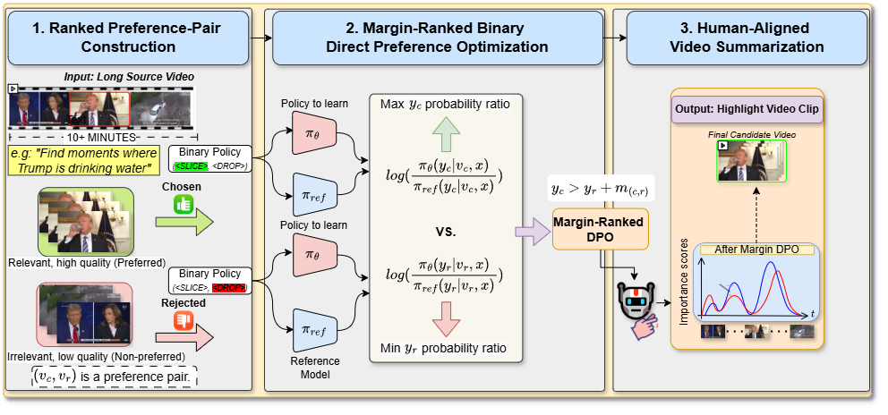

# VSLICE: Margin-Ranked Binary Preference Alignment for Video Summarization with Large Vision-Language Models

VSLICE is a model alignment framework that adapts Large Vision-Language Models (LVLMs) to video summarization. Instead of generating open-ended text, the LVLM answers one binary question per subclip with a dedicated action token, **`<SLICE>`** (keep) or **`<DROP>`** (discard), and these binary scores are aligned with human importance scores through **Margin-Ranked Direct Preference Optimization (Margin-DPO)**, which preserves both the *order* and the *strength* of human preferences. Open-source LVLMs (MiniCPM-V, Qwen2.5-VL and Moondream) are fine-tuned with LoRA, and the full pipeline runs on a single 8 GB RTX 3070.

---

## 🔍 Overview

LVLMs can recognise visual concepts, but are poor at **ranking** how important one video moment is relative to another:
- Text-centric summarizers (caption the frames, then ask an LLM for a score) lose fine-grained spatio-temporal context, and scores read from generated text reflect sentence likelihood rather than visual importance.
- Zero-shot LVLMs over-attribute background frames that share context with the query, and fall toward random choice when two clips differ only slightly in human importance.

**VSLICE addresses this by:**
1. **Binary prompt decomposition:** constraining the output to two action tokens, `<SLICE>`/`<DROP>`, and reading the score from the first decoding step.
2. **Margin preference-pair selection:** pairing high- and low-scored subclips of the same video, each pair carrying a margin from the human scores.
3. **Margin-Ranked DPO:** aligning the binary scores with those pairs, so stronger human preferences require larger confidence gaps.

---

## ✨ Key Features

- **Binary action tokens**: `<SLICE>` / `<DROP>` are added to the tokenizer.
- **Margin-ranked preference alignment**: continuous ground-truth score ratios enter the DPO objective as pair-specific log-margins.
- **Multi-backbone LVLM support**: `MiniCPM-V-2_6`, `Qwen2.5-VL-3B/7B-Instruct` and `Moondream2`.
- **Standard evaluation**: 5-fold splits on **SumMe** and **TVSum**, reporting Kendall's $\tau$, Spearman's $\rho$ and F1.
- **Low resource**: Training and inference fit on a single NVIDIA RTX 3070 (8 GB).

---

## 🧠 Method

Training is implemented in [`vslice/vslice_dpo.py`](vslice/vslice_dpo.py).

<p align="center">
  
</p>

---

## ⚙️ Installation & Environment

### 1. Clone & Set Up Conda Environment

```bash
git clone https://github.com/dexterdley/VSLICE.git
cd VSLICE

conda env create -f environment.yml
conda activate VSLICE
```

### 2. Download Pretrained Multimodal Backbones

#### MiniCPM-V 2.6
Download the model weights into the repository root:
```bash
git lfs install
git clone https://huggingface.co/openbmb/MiniCPM-V-2_6-int4
```
Qwen2.5-VL and Moondream2 can be loaded directly from HuggingFace.

---

## 📂 Dataset Preparation & Pathing

Place the benchmark datasets and their raw videos in their corresponding directories:

```
VSLICE/
├── SumMe/
│   ├── eccv16_dataset_summe_google_pool5.h5
│   └── raw/videos/*.mp4
├── TVSum/
│   ├── eccv16_dataset_tvsum_google_pool5.h5
│   └── raw/ydata-tvsum50-v1_1/video/*.mp4
└── dataset/
    ├── summe_splits.json
    └── tvsum_splits.json
```

---

## 🚀 Training & Evaluation

Each run trains a LoRA adapter per split and evaluates it on that split's test videos. See [`vslice/run.sh`](vslice/run.sh).

### CLI Arguments

| Argument | Type | Default | Description |
| :--- | :--- | :--- | :--- |
| `--model_type` | `str` | `minicpm` | LVLM backbone: `minicpm`, `qwen2_vl_3b` or `qwen2_vl_7b` |
| `--model_path` | `str` | `None` | Local path / HuggingFace ID of the backbone (defaults per `--model_type`) |
| `--dataset` | `str` | — | Dataset: `summe` or `tvsum` |
| `--split_file` | `str` | `./dataset/summe_splits.json` | Path to the JSON split definitions |
| `--root_dir` | `str` | `.` | Root directory of the dataset files |
| `--loss_type` | `str` | `DPO` | Preference objective; `DPO` is the Margin-DPO loss above |
| `--beta` | `float` | `0.1` | DPO temperature (strength of deviation from the reference model) |
| `--clip_length` | `int` | `4` | Frames per subclip $N$ |
| `--batch_size` | `int` | `2` | Preference pairs per step |
| `--num_epochs` | `int` | `5` | Training epochs per split |
| `--learning_rate` | `float` | `1e-5` | Learning rate for 8-bit AdamW |
| `--weight_decay` | `float` | `1e-5` | AdamW weight decay |
| `--warmup_ratio` | `float` | `0.1` | Fraction of steps for the cosine-schedule warmup |
| `--seed` | `int` | `42` | Random seed |
| `--output_dir` | `str` | `./checkpoints` | Output folder for the best LoRA weights |

### Running on SumMe

```bash
python vslice/vslice_dpo.py \
    --dataset summe \
    --split_file ./dataset/summe_splits.json \
    --model_type minicpm \
    --batch_size 2 \
    --clip_length 4 \
    --num_epochs 5 \
    --beta 0.1 \
    --learning_rate 5e-5 \
    --loss_type DPO
```

### Running on TVSum

```bash
python vslice/vslice_dpo.py \
    --dataset tvsum \
    --split_file ./dataset/tvsum_splits.json \
    --model_type minicpm \
    --batch_size 2 \
    --clip_length 4 \
    --num_epochs 3 \
    --beta 0.1 \
    --learning_rate 5e-5 \
    --loss_type DPO
```

---

## 🤖 Use of AI Tools

Claude AI was used in parts to **assist** with the routine work on this repository, such as drafting documentation, the project page and supporting scripts. All code, results and written content were **thoroughly reviewed and verified** by the main author.